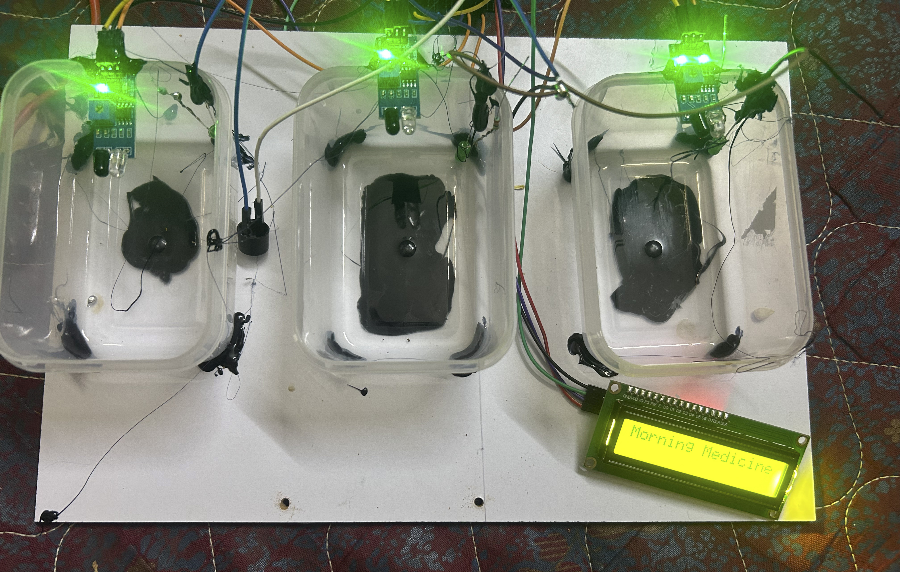

# Smart Pill Box Reminder with Family Notifications

An experimental pill box system that reminds users to take their medicine and sends a Telegram notification to a family member if a dose is missed.

## Overview

The system uses three IR sensors to monitor three medicine compartments. Each compartment has its own LED indicator. A 16×2 LCD displays reminders, and a buzzer sounds an alarm when medicine is due. If medicine is not taken within the set time, the ESP32 sends a Telegram notification to a family member.

## Key Features

- Monitors three medicine compartments using IR sensors
- Uses one LED for each compartment
- Displays reminders and medicine status on a 16×2 LCD
- Sounds a buzzer alarm
- Sends a Telegram notification to a family member if a dose is missed

## System Design

Each IR sensor monitors one medicine compartment. The ESP32 checks whether medicine has been taken according to the schedule. It updates the corresponding LED and LCD and sounds the buzzer when a reminder is due. If the dose is still not taken after the set time, the ESP32 sends a Telegram notification to a family member.

## Hardware Components

| Component | Quantity | Purpose |
|---|---:|---|
| ESP32 | 1 | Reads sensors, controls reminders, and sends Telegram notifications |
| IR sensor | 3 | Monitors each medicine compartment |
| LED | 3 | Indicates the status of each compartment |
| Buzzer | 1 | Sounds the medicine reminder |
| 16×2 LCD | 1 | Displays reminders and medicine status |

## Software and Tools

- Programming language: Arduino C/C++
- IDE: Arduino IDE
- Notification service: Telegram

## Source Code

The Arduino IDE source code is included in this repository: [`pill.ino`](pill.ino).

## Project Photo

## How It Works

1. The ESP32 monitors the three medicine compartments using the IR sensors.
2. At a scheduled medicine time, the system displays a reminder and activates the corresponding LED and buzzer.
3. If the medicine is not taken within the set time, the ESP32 sends a Telegram notification to a family member.

## How to Build and Run

1. Connect the IR sensors, LEDs, buzzer, and 16×2 LCD to the ESP32.
2. Set the medicine reminder times in the program.
3. Configure the ESP32 Wi-Fi connection and Telegram bot details.
4. Upload the program to the ESP32 using the Arduino IDE.
5. Test each compartment, reminder, and Telegram notification.

## Limitations and Future Improvements

- IR sensor readings may need adjustment for the pill box and room conditions.
- Telegram notifications require an internet connection.
- Future improvements could include a phone app and a configurable medicine schedule.

## Team and Contributions

- Meenakshi Sundaram — designed and built the project independently.
